# color-kit

A queryable color-space engine for building color tooling.

<p align="center">
  
</p>

<p align="center"><sub>Generated by the engine itself with <code>definePlane</code> → <code>sense</code> → <code>toSvgPath</code> (<a href="./scripts/generate-readme-hero.mjs"><code>scripts/generate-readme-hero.mjs</code></a>).</sub></p>

Most color libraries convert and manipulate colors. color-kit does too, but its core is a **queryable model of color-space geometry**: define a 2D plane through a color space, then ask it for gamut boundaries, contrast regions and safe-color solutions as resolution-independent geometry. Colors are OKLCH-canonical: values are stored in OKLCH, a perceptually uniform space, and other formats are input and output. The engine is plain TypeScript with no DOM or UI framework dependency, and its SVG output is path strings. The React bindings are one consumer of the engine.

## Packages

Everything ships in one npm package, [`@pbroom/color-kit`](./packages/color-kit), split into subpath entry points so you only load what you import:

| Import path                 | What it contains                                                                                                     |
| --------------------------- | -------------------------------------------------------------------------------------------------------------------- |
| `@pbroom/color-kit`         | The everyday toolkit (parsing, conversion, contrast, harmony, manipulation, gamut mapping) plus the plane essentials |
| `@pbroom/color-kit/core`    | Alias of the root entry                                                                                              |
| `@pbroom/color-kit/plane`   | The full plane API: standalone queries, query cache, region operations, inspection and trace types                   |
| `@pbroom/color-kit/compute` | Plane compute scheduling on the JS backend, with telemetry                                                           |
| `@pbroom/color-kit/hct`     | HCT helpers, isolating the bundled Material color utilities solver                                                   |
| `@pbroom/color-kit/interop` | Tuples and typed arrays for GPU pipelines, three.js, and WebGL/WebGPU                                                |
| `@pbroom/color-kit/driver`  | Framework-agnostic interaction driver: color state, area/slider mapping, per-channel read/write math                 |
| `@pbroom/color-kit/react`   | React state hooks plus plane renderer and geometry hooks (optional peers: `react`, `react-dom` 19+)                  |

The docs site's API section has a generated reference for every entry point (generate its data locally with `pnpm docs:api`).

## Stability Policy

This project is in a pre-production phase:

- Public packages stay on `0.x.y`.
- Breaking changes may land in minor releases while APIs are still settling.
- `npm` publishes use the `next` dist-tag until `1.0.0` readiness.
- CI blocks accidental `>=1.0.0` workspace package versions.

## React Baseline

- `@pbroom/color-kit/react` targets React `19+`.
- Workspace defaults pin React and React DOM to the latest `19.x`.
- Docs builds run the React Compiler (`babel-plugin-react-compiler`) by default.
- Repo lint enforces compiler-safe patterns (`react-hooks` recommended-latest + `react-compiler` rule).
- Decision: `@pbroom/color-kit/react` stays lint-enforced (not compiler-precompiled) for now, since the current `tsup` library pipeline does not run Babel compiler transforms.

## Install

```bash
pnpm add @pbroom/color-kit@next
```

## Quick Start

### Plane queries (the engine)

Define a plane through a color space and query its geometry:

```ts
import { definePlane, displayP3, sense, toSvgPath } from '@pbroom/color-kit';

const plane = definePlane({
  model: 'oklch',
  x: { channel: 'l', range: [0, 1] },
  y: { channel: 'c', range: [0, 0.4] },
  fixed: { h: 250, alpha: 1 },
});

const query = sense(plane);
const boundary = query.gamutBoundary({ gamut: displayP3 });
const d = toSvgPath(boundary.points); // resolution-independent SVG path
```

Gamut visualizations, contrast-safe pickers and other tools that reason about the shape of a color space, rather than individual colors, build on this layer.

### Everyday toolkit

```typescript
import {
  parse,
  toHex,
  lighten,
  contrastRatio,
  complementary,
} from '@pbroom/color-kit';

// Parse CSS Color 4 strings: hex, named colors, rgb(), hsl(), lab(), oklch(), color()
const blue = parse('#3b82f6');

// Manipulate in OKLCH space
const light = lighten(blue, 0.2);
console.log(toHex(light));

// Check accessibility
const white = parse('#ffffff');
console.log(contrastRatio(blue, white)); // WCAG 2.1

// Generate harmonies
const comp = complementary(blue);
```

### Driver (framework-agnostic UI logic)

`@pbroom/color-kit/driver` holds the interaction math for color UI, with no
framework dependency: area/slider coordinate mapping, reading and writing
single OKLCH, RGB or HSL channels, slider gradient sampling, and the dual
requested/displayed color state model. Use it from React, Svelte, plain DOM or canvas code.

```typescript
import { parse } from '@pbroom/color-kit';
import * as ColorApi from '@pbroom/color-kit/driver';

const state = ColorApi.createColorState(parse('#3b82f6'));

const axes = ColorApi.resolveColorAreaAxes({
  x: { channel: 'l' },
  y: { channel: 'c' },
});
const next = ColorApi.colorFromColorAreaPosition(
  state.requested,
  axes,
  0.5,
  0.25,
);

const gradient = ColorApi.getSliderGradientStyles({
  model: 'oklch',
  channel: 'h',
  baseColor: state.requested,
  range: ColorApi.resolveColorSliderRange('h'),
});
```

### React (one binding)

React hooks consume the same engine: state hooks hold and share a color, and plane hooks paint a color plane into your canvas and return overlay geometry for your SVG. They render nothing, so markup, styling and input handling stay yours (the framework-agnostic driver supplies the picker math). Other bindings can be built on the driver layer the same way.

```tsx
import {
  useColor,
  useColorPlaneRenderer,
  useGamutBoundary,
} from '@pbroom/color-kit/react';

function PlanePreview() {
  const { requested } = useColor({ defaultColor: '#3b82f6' });
  const { ref, canvasKey } = useColorPlaneRenderer({ color: requested });
  const srgb = useGamutBoundary({ color: requested }, { gamut: 'srgb' });
  return (
    <div style={{ position: 'relative', width: 240, height: 160 }}>
      <canvas
        ref={ref}
        key={canvasKey}
        style={{
          position: 'absolute',
          inset: 0,
          width: '100%',
          height: '100%',
        }}
      />
      <svg
        viewBox="0 0 100 100"
        preserveAspectRatio="none"
        style={{ position: 'absolute', inset: 0 }}
      >
        <path
          d={srgb.path}
          fill="none"
          stroke="#fff"
          vectorEffect="non-scaling-stroke"
        />
      </svg>
    </div>
  );
}
```

### Dual-State React Contract

`useColor` and `Color` expose explicit requested/displayed state:

- `requested`: canonical OKLCH user intent
- `displayed`: deterministic gamut-mapped output (`srgb` and `display-p3`)

```tsx
const color = useColor({ defaultColor: '#3b82f6' });

color.requested; // exact editable state
color.displayed; // active rendered state
color.setRequested({ l: 0.7, c: 0.2, h: 250, alpha: 1 });
```

### Multi-Color State

`useMultiColor` manages named color collections with shared gamut/view settings.

```tsx
const palette = useMultiColor({
  defaultColors: { base: '#3b82f6', accent: 'oklch(0.8 0.4 145)' },
});

palette.setChannel('accent', 'h', 220, { interaction: 'user' });
palette.setActiveGamut('srgb');
```

## Core API

### Plane Geometry

`definePlane()` `definePlaneFromColor()` `sense()` `toSvgPath()` `toSvgCompoundPath()` `colorToPlane()` `planeToColor()`

From `@pbroom/color-kit/plane`: `runPlaneQuery()` `runPlaneQueries()` `PlaneQueryCache()` `inspectPlaneQuery()`, region operations (`unionRegions()` `intersectRegions()` `differenceRegions()` `containsPoint()`) and transforms.

### Conversion

`parse()` `tryParse()` `toHex()` `toRgb()` `toHsl()` `toHsv()` `toOklch()` `toOklab()` `toP3()` `toCss()` `fromRgb()` `fromHex()` `fromHsl()` `fromHsv()` `fromOklch()` `fromOklab()` `fromP3()`

### Contrast

`contrastRatio()` `contrastAPCA()` `meetsAA()` `meetsAAA()` `relativeLuminance()` `ensureContrast()` `tryEnsureContrast()`

`ensureContrast(color, reference, options)` returns the closest color that meets a WCAG or APCA threshold by changing OKLCH lightness only: hue is kept, and chroma is reduced only where the target gamut requires it. `tryEnsureContrast()` returns `null` instead of throwing when no lightness reaches the threshold. For the nearest passing point in any plane (not just along lightness), use the `contrastPoint` plane query: `sense(plane).contrastPoint({ color, reference, gamut })`.

### Color difference

`deltaEOK()` `deltaE2000()`

`deltaEOK()` is the Euclidean distance in OKLab (black to white is 1). `deltaE2000()` is CIEDE2000 in CIE Lab D50 (black to white is 100). Both ignore alpha and accept colors outside sRGB.

### Harmony

`complementary()` `analogous()` `triadic()` `tetradic()` `splitComplementary()`

### Scale

`generateScale()` `interpolate()` `lightnessScale()`

`mix()`, `interpolate()`, and `generateScale()` take an optional `{ space, hue, premultiplied }` argument. It lets you interpolate in `oklch` (the default), `oklab`, `srgb`, `linear-srgb`, `display-p3`, or `linear-p3` with CSS `color-mix()` semantics. For example, `mix(red, lime, 0.5, { space: 'linear-srgb' })` gives a physically correct linear-light blend.

### Manipulation

`lighten()` `darken()` `saturate()` `desaturate()` `adjustHue()` `mix()` `setAlpha()` `invert()` `grayscale()`

### Gamut

`srgb` `displayP3` `a98Rgb` `rec2020` `inGamut()` `toGamut()` `inSrgbGamut()` `inP3Gamut()` `inRec2020Gamut()` `toSrgbGamut()` `toP3Gamut()` `toRec2020Gamut()` `maxChromaAt()` `maxChromaForHue()` `gamutBoundaryPath()` `chromaBand()`

A gamut is an imported object, never a string. Every core `gamut` option, including the plane queries' and the contrast functions', takes a `Gamut` descriptor: `srgb` (the default), `displayP3`, `a98Rgb` (Adobe RGB (1998), CSS `a98-rgb`), `rec2020`, or one of your own. Bundles carry only the gamuts they import, and a custom gamut is an object of the same shape with its own `id`, so it works exactly like a built-in. Descriptors are plain data and survive `structuredClone` and `postMessage`. Passing a string such as `'display-p3'` throws a `TypeError`; replace `{ gamut: 'display-p3' }` with `{ gamut: displayP3 }`.

```ts
import {
  inP3Gamut,
  inRec2020Gamut,
  maxChromaAt,
  rec2020,
  toRec2020Gamut,
  type Gamut,
} from '@pbroom/color-kit';

const vivid = { l: 0.8, c: 0.4, h: 150, alpha: 1 };
inP3Gamut(vivid); // false
inRec2020Gamut(vivid); // true
maxChromaAt(0.6, 250, { gamut: rec2020 }); // 0.24578857421875
toRec2020Gamut({ l: 0.7, c: 0.5, h: 150, alpha: 1 }).c; // ≈ 0.3612

// A custom gamut: the same shape with a unique id (caches key on it).
const mine: Gamut = { ...rec2020, id: 'my-gamut' };
maxChromaAt(0.6, 250, { gamut: mine }); // 0.24578857421875
```

Plane query results carry the descriptor back (`result.gamut.id` is `'srgb'`, `'display-p3'`, `'a98-rgb'` or `'rec2020'`). `toCss(color, 'rec2020')` still takes a format name and writes `color(rec2020 r g b)`. The driver and React picker state model the gamut a color is displayed in and keep taking the strings `'srgb'` or `'display-p3'` (`activeGamut`, `setActiveGamut`, hook and component `gamut` options). Rec. 2020 holds all of sRGB but not quite all of Display P3: two thin slivers of P3, around its red primary and around its cyan near white, lie outside it.

### Allocation-free variants

For per-pixel and per-frame loops, the hot-path functions have `*Into` twins that write into a caller-supplied `out` object (passed first) and return it. They create no result or intermediate objects and return bit-identical results to the allocating functions, which are thin wrappers over them. That is not a guarantee of zero heap allocation: JavaScript engines may still box the numbers written into object fields (V8 does in loops it does not fully inline and optimize), and V8 often optimizes away the allocating functions' short-lived objects anyway. The object-returning API stays the default; reach for `*Into` only where a profiler shows allocation or GC pressure, and benchmark the change at your call site.

`toOklabInto()` `fromOklabInto()` `toLinearSrgbInto()` `fromLinearSrgbInto()` `toRgbInto()` `fromRgbInto()` `toP3Into()` `fromP3Into()` `mixInto()` `interpolateInto()` `toSrgbGamutInto()` `toP3GamutInto()` `toRec2020GamutInto()`

Low-level converters: `srgbToLinearInto()` `linearToSrgbInto()` `linearRgbToOklabInto()` `oklabToLinearRgbInto()` `oklabToOklchInto()` `oklchToOklabInto()` `linearSrgbToLinearP3Into()` `linearP3ToLinearSrgbInto()` `linearP3ToP3Into()` `p3ToLinearP3Into()`

```ts
import { interpolateInto, parse, toRgbInto } from '@pbroom/color-kit';

const from = parse('#3b82f6');
const to = parse('#ef4444');
const color = { l: 0, c: 0, h: 0, alpha: 1 };
const rgb = { r: 0, g: 0, b: 0, alpha: 1 };
for (let x = 0; x < width; x++) {
  const t = width > 1 ? x / (width - 1) : 0; // a 1px strip shows `from`
  toRgbInto(rgb, interpolateInto(color, from, to, t));
  // write rgb.r / rgb.g / rgb.b into ImageData
}
```

### Array Interop (GPU, three.js, WebGL/WebGPU)

Import from `@pbroom/color-kit/interop`; these are not on the root entry.

`to<Space>Array()` `to<Space>Array4()` `from<Space>Array()` `from<Space>Array4()` `packColors()` `unpackColors()`, where `<Space>` is `LinearSrgb`, `Srgb`, `LinearP3`, `P3`, `Oklab`, or `Oklch`.

Writers take `(color, out?, offset = 0, { clamp? })`, write into any `number[]` or typed array without allocating, and emit unclamped floats by default. `*Array4` variants append alpha. To gamut-map instead of clip, compose: `toLinearSrgbArray(toSrgbGamut(color), out)` or `packColors(colors.map(toSrgbGamut), 'linearSrgb')`.

```ts
import { toLinearSrgbArray, packColors } from '@pbroom/color-kit/interop';

// three.js stores linear sRGB (its default working color space).
mesh.material.color.fromArray(toLinearSrgbArray(color));

// WebGL uniform, reusing one scratch buffer.
gl.uniform3fv(loc, toLinearSrgbArray(color, scratch));

// WebGPU storage buffer: array<vec4f> of linear sRGB + alpha.
device.queue.writeBuffer(
  buffer,
  0,
  packColors(colors, 'linearSrgb', undefined, { alpha: true }),
);
```

## Development

```bash
# Install dependencies
pnpm install

# Build all packages
pnpm build

# Run tests
pnpm test

# Start docs dev server (instant; reads workspace packages from source)
pnpm dev

# Start docs dev server AND watch-build the publishable packages
# (only needed when validating the built dist output, not for normal docs/component work)
pnpm dev:full
```

## Publishing (Maintainers)

Versions and the `@pbroom/color-kit` changelog come from [Changesets](https://github.com/changesets/changesets): add one with `pnpm changeset`, and merging the automated "Version Packages" PR bumps the version. Publishing stays manual. See [CONTRIBUTING.md](./CONTRIBUTING.md#releases) for the full flow.

```bash
# Validate pre-production policy, then publish color-kit to npm @next
pnpm publish:next

# Same flow without publishing artifacts
pnpm publish:next:dry
```

## Agent Learnings Workflow

Agent learnings use a split model:

- `AGENTS.md` stores only the top 10 active evergreen learnings for fast agent context.
- `AGENTS.learnings.archive.md` is the full historical source of truth.

Use these commands:

```bash
# Add to archive only
pnpm agents:add -- --title "Short title" --lesson "Actionable lesson"

# Add/update archive and promote to active (keeps active list capped at 10)
pnpm agents:add -- --title "Short title" --lesson "Actionable lesson" --active

# Non-blocking checks (warnings only)
pnpm agents:check

# Strict checks (fails on warnings)
pnpm agents:check:strict
```

## License

[MIT](./LICENSE). The published package bundles the HCT solver from [Material color utilities](https://github.com/material-foundation/material-color-utilities) (Apache-2.0); see [THIRD_PARTY_NOTICES.md](./packages/color-kit/THIRD_PARTY_NOTICES.md).
